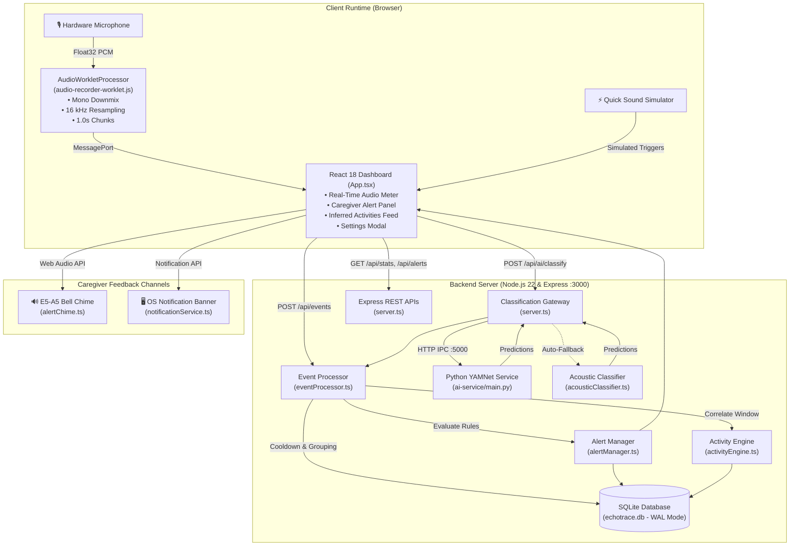

# EchoTrace 🎧
### Intelligent Ambient Sound Memory Assistant & Caregiver Alert System

> **A privacy-first, on-device ambient acoustic monitoring assistant designed for dementia caregivers, elderly home safety, and memory reconstruction.**

[](LICENSE)
[](https://nodejs.org/)
[](https://www.python.org/)
[](https://www.typescriptlang.org/)
[](docs/TESTING.md)

---

## Table of Contents

1. [Executive Summary & Problem Statement](#executive-summary--problem-statement)
2. [Target Audience & Real-World Use Cases](#target-audience--real-world-use-cases)
3. [Key Features & Capabilities](#key-features--capabilities)
4. [System Architecture](#system-architecture)
5. [Technology Stack](#technology-stack)
6. [Complete Application Workflow](#complete-application-workflow)
7. [Repository File Structure](#repository-file-structure)
8. [Prerequisites & Installation (Windows & Cross-Platform)](#prerequisites--installation)
9. [Running the Application](#running-the-application)
10. [Environment Configuration](#environment-configuration)
11. [REST API Endpoints](#rest-api-endpoints)
12. [Database Architecture (SQLite WAL)](#database-architecture-sqlite-wal)
13. [Automated Testing Results](#automated-testing-results)
14. [Step-by-Step Demonstration Guide](#step-by-step-demonstration-guide)
15. [Security & Privacy Guarantee](#security--privacy-guarantee)
16. [Known Limitations & Fallback Strategy](#known-limitations--fallback-strategy)
17. [Future Enhancements](#future-enhancements)
18. [Contributors & License](#contributors--license)

---

## Executive Summary & Problem Statement

### The Problem
Over 55 million people worldwide live with dementia or Alzheimer's disease. Caregivers face constant anxiety regarding their loved ones' daily safety: *Did they remember to eat? Was the water faucet left running? Did a glass break? Has anyone entered or left the house?* 

Traditional monitoring solutions rely on invasive video cameras, which violate resident dignity and privacy, or wearable smart devices that individuals with cognitive decline often forget, lose, or remove.

### The Solution: EchoTrace
**EchoTrace** is an ambient sound memory assistant that listens for familiar household acoustic patterns—such as keys jingling, water taps running, dishes clattering, doors knocking, and footsteps—and maps them to a private local activity timeline. 

EchoTrace operates with **strict on-device processing**: ambient audio is evaluated in transient 1.0-second floating-point memory buffers and discarded immediately. No raw audio files, speech recordings, or private conversations are ever written to disk or sent to the cloud. Caregivers receive instant alerts for emergencies (smoke alarms, shattered glass) and high-level daily routine summaries without compromising resident privacy.

---

## Target Audience & Real-World Use Cases

* **Family Caregivers:** Review a loved one's daily routine (e.g. confirming breakfast preparation or nighttime wandering) without installing invasive cameras in living quarters.
* **Assisted Living & Memory Care Communities:** Monitor common rooms, hallways, and private suites for unattended running faucets, appliance alarms, or potential falls.
* **Elderly Individuals Living Independently:** Maintain personal privacy while providing remote family members with reassurance that household routines are normal.
* **Clinical Healthcare Visits:** Export objective, time-stamped CSV reports detailing activity frequency and alert history for physicians and occupational therapists.

---

## Key Features & Capabilities

* 🎙️ **Hardware-Agnostic Audio Capture:** Web Audio `AudioWorkletProcessor` downmixes arbitrary channel inputs to mono and dynamically resamples any source rate (44.1 kHz, 48 kHz, 96 kHz) to 16 kHz.
* 🧠 **Dual-Engine Sound Classification:** Integrates Google's 521-class YAMNet neural network with a resilient built-in TypeScript Acoustic Spectral Classifier fallback.
* ⚡ **Intelligent Event Smoothing:** Dynamic confidence filtering, duplicate cooldown suppression (4s), and continuous event grouping (12s for running water, footsteps, and vacuums).
* 🏠 **Activity Intelligence Engine:** Clusters sound patterns over trailing time windows to infer daily living routines (*Kitchen Meal Prep*, *Bathroom Hygiene*, *Room Transitions*, *Media & Leisure*).
* 🚨 **Caregiver Alert System:** Immediate severity routing for Critical (Smoke alarms) and High (Glass breaking) events with 3-minute duplicate alert suppression.
* 🔊 **Harmonic Melodic Chime:** Synthesizes an audible E5 (659.25 Hz) $\rightarrow$ A5 (880.00 Hz) bell sequence using Web Audio oscillators.
* 🖥️ **Desktop Notifications:** Dispatches OS notification banners via Web Notification API with click-to-focus window management.
* ⚙️ **Centralized Settings Modal:** Configure confidence thresholds, cooldown windows, and alert toggles directly in UI with atomic SQLite persistence.
* 🗂️ **Multi-Tab Session Isolation:** Independent tab sessions tracked via `sessionStorage` and backend regex validation, supporting filtered event queries.
* 📥 **Caregiver CSV Export:** One-click download of structured caregiver reports containing events, activities, and alerts.

---

## System Architecture



---

## Technology Stack

| Layer | Technologies | Role / Purpose |
| :--- | :--- | :--- |
| **Frontend** | React 18, TypeScript 5.6, Vite 6 | Single-Page Application, responsive dark dashboard |
| **Audio Processing** | Web Audio API, `AudioWorkletProcessor` | Low-latency audio acquisition, mono averaging, 16 kHz linear resampling |
| **Backend API** | Node.js 22, Express 4.21, `tsx` | REST endpoints, process management, transaction handling |
| **AI / Machine Learning** | Google YAMNet (TensorFlow Hub), AudioSet 521 Class Map | Deep convolutional audio event classification |
| **Fallback Engine** | Node.js Acoustic Spectral Engine | Zero-Crossing Rate (ZCR), RMS energy, crest factor, segment variance |
| **Database** | SQLite 3 (`better-sqlite3`), WAL Mode | Local persistence of events, activities, alerts, and settings |
| **Notifications** | Web Audio API oscillators, Web Notification API | Synthesized E5 $\rightarrow$ A5 bell chimes and native OS desktop alerts |
| **Automated Testing** | TypeScript test runners, Python `unittest` | 6 comprehensive automated test suites (120 assertions) |

---

## Complete Application Workflow

```
1. Audio Capture:
   Physical Mic ──> getUserMedia() ──> AudioWorkletProcessor (runs on dedicated audio thread)
   
2. Preprocessing & Normalization:
   AudioWorklet averages channels to mono ──> resamples to 16,000 Hz ──> emits 16,000-sample float32 chunk (1.0s)
   
3. Energy Gating:
   If RMS energy < 0.012 (silence) ──> chunk is discarded without network transmission
   If RMS energy >= 0.012 ──> POST /api/ai/classify with float32 samples and client session ID
   
4. Model Classification:
   Express gateway forwards to Python YAMNet Service (:5000)
   ├── Primary: Google YAMNet evaluates 521 AudioSet classes via mean pooling across spectrogram frames
   └── Fallback: If Python/TensorFlow is unavailable, Node.js Acoustic Spectral Classifier executes instantly
   
5. Intelligent Event Processing:
   Confidence Filter: Drops predictions below confidence_threshold (default 0.40)
   ├── Continuous Grouping: Running water or footsteps merge into existing events, extending duration
   └── Duplicate Cooldown: Impulsive sounds (knocks, doors) within 4s are suppressed
   
6. Caregiver Alerting & Activity Interpretation:
   ├── Critical sounds (smoke alarm) trigger high-priority alerts with 3-minute deduplication
   ├── Trailing sound clusters (e.g. tap + dishes + coffee maker) infer high-level routines ("Kitchen Activity")
   └── Events, alerts, and activities are persisted to SQLite (echotrace.db)
   
7. Real-Time Feedback Delivery:
   Dashboard updates via live polling ──> audible E5-A5 chime plays ──> OS desktop notification appears
```

---

## Repository File Structure

```text
EchoTrace/
├── .env.example                     # Environment configuration template
├── .gitignore                       # Git ignore rules for node_modules, DB, and cache
├── index.html                       # HTML5 entry point with Inter font and metadata
├── metadata.json                    # Application metadata and capabilities
├── package.json                     # Node.js dependencies, devDependencies, and test scripts
├── server.ts                        # Express API server and Vite middleware integration
├── tsconfig.json                    # TypeScript compiler configuration
├── vite.config.ts                   # Vite bundler configuration
│
├── ai-service/                      # Python YAMNet AI Classification Service
│   ├── audio_processor.py           # Audio decoding, linear resampling, and normalization
│   ├── config.py                    # AI service configuration, URLs, and target classes
│   ├── detector.py                  # YAMNet model loader, inference runner, and fallback engine
│   ├── main.py                      # HTTP inference server running on port 5000
│   ├── requirements.txt             # Python dependencies (tensorflow, tensorflow-hub, scipy)
│   └── yamnet_class_map.csv         # 521 AudioSet class display names
│
├── docs/                            # In-Depth Project Documentation
│   ├── ARCHITECTURE.md              # Complete architectural specifications and data flow
│   ├── DEMO_GUIDE.md                # Step-by-step evaluator demonstration script
│   └── TESTING.md                   # Comprehensive testing guide and test outputs
│
├── public/                          # Static Web Assets
│   └── audio-recorder-worklet.js    # Custom AudioWorkletProcessor for 16 kHz mono capture
│
├── server/                          # Server-Side Services & Database
│   ├── database/
│   │   ├── db.ts                    # SQLite database connection, WAL pragmas, and migrations
│   │   └── seed.ts                  # Sample events, activities, and alerts initialization
│   └── services/
│       ├── acousticClassifier.ts    # Built-in Node.js spectral feature classification fallback
│       ├── activityEngine.ts        # Routine inference engine (Kitchen, Hygiene, Transition)
│       ├── alertManager.ts          # Caregiver alert generator, rules, and deduplication
│       ├── eventProcessor.ts        # Event smoothing (confidence, cooldown, continuous grouping)
│       └── reportGenerator.ts       # Analytics calculations and RFC-compliant CSV report generator
│
├── src/                             # React 18 Frontend Application
│   ├── components/
│   │   └── SettingsModal.tsx        # Centralized settings modal (4 tabs, sliders, live preview)
│   ├── utils/
│   │   ├── alertChime.ts            # Web Audio harmonic two-tone chime synthesizer
│   │   └── notificationService.ts   # Web Notification API permissions and dispatch
│   ├── App.tsx                      # Main caregiver dashboard, live feed, visualizer, simulator
│   ├── config.ts                    # Frontend constants, default rooms, and target classes
│   ├── main.tsx                     # React DOM entry point
│   └── types.ts                     # TypeScript shared interfaces (Event, Activity, Alert, Settings)
│
└── tests/                           # Automated Test Suites (120 Assertions)
    ├── test-backend.ts              # SQLite, event processor, activity engine & CSV tests
    ├── test-notifications.ts        # Caregiver alerts, suppression, notification & chime tests
    ├── test-sessions.ts             # Session ID validation, migrations, and multi-session tests
    ├── test-settings.ts             # Centralized settings persistence & validation bounds tests
    └── test-yamnet-inference.py      # AudioSet mapping, audio decoding, and resampling tests
```

---

## Prerequisites & Installation

### System Prerequisites
* **Operating System:** Windows 10/11, macOS, or Linux.
* **Node.js:** Version 18.0.0 or higher (Node.js 22 LTS recommended).
* **Python:** Version 3.9, 3.10, or 3.11 (Required for Python AI service).
* **Microphone:** Built-in or USB microphone accessible by your web browser.

---

### Step 1: Clone the Repository
```powershell
git clone https://github.com/Kaviyasree-N/EchoTrace.git
cd EchoTrace
```

### Step 2: Install Node.js Dependencies
```powershell
npm install
```

### Step 3: Set Up Python AI Service (Windows PowerShell)
```powershell
# Create Python virtual environment
python -m venv venv

# Activate virtual environment
.\venv\Scripts\Activate.ps1

# Upgrade pip and install requirements
python -m pip install --upgrade pip
pip install -r ai-service\requirements.txt
```

> **PowerShell Execution Note:** If PowerShell reports script execution is disabled, enable it by running:  
> `Set-ExecutionPolicy -ExecutionPolicy RemoteSigned -Scope CurrentUser`

---

## Running the Application

### Method A: Single Command Launch (Recommended)
Running `npm run dev` starts the Express server, mounts the Vite frontend on port `3000`, and automatically launches the Python YAMNet AI Service as a background child process:

```powershell
npm run dev
```
Open **`http://localhost:3000`** in Google Chrome, Microsoft Edge, or Mozilla Firefox.

### Method B: Separate Terminals (For Detailed Model Logs)

**Terminal 1 (Python YAMNet Service):**
```powershell
.\venv\Scripts\Activate.ps1
python ai-service\main.py
```

**Terminal 2 (Express Backend + Vite Frontend):**
```powershell
npm run dev
```

---

## Environment Configuration

Copy the `.env.example` file to create your local `.env`:
```powershell
cp .env.example .env
```

| Variable | Default Value | Purpose |
| :--- | :--- | :--- |
| `PORT` | `3000` | Port for the Express server and Vite frontend |
| `HOST` | `0.0.0.0` | Network binding host (`0.0.0.0` binds to all network interfaces) |
| `ECHOTRACE_DB_PATH` | `echotrace.db` | Custom filesystem path for SQLite database |

---

## REST API Endpoints

| Method | Endpoint | Description |
| :--- | :--- | :--- |
| `GET` | `/api/ai/status` | Reports AI inference engine status, model readiness, and class counts |
| `POST` | `/api/ai/classify` | Ingests 16 kHz audio samples or base64 WAV payload and returns sound predictions |
| `GET` | `/api/events` | Queries sound events with filters (`q`, `room`, `source`, `session`, `startDate`, `endDate`, `limit`) |
| `POST` | `/api/events` | Inserts a sound detection and runs event smoothing, alerts, and activity engine |
| `DELETE` | `/api/events` | Clears all historical events, activities, and alerts (requires `{ confirm: true }`) |
| `GET` | `/api/alerts` | Retrieves caregiver alerts with unacknowledged counts (`onlyUnacknowledged=true`) |
| `POST` | `/api/alerts/:id/ack` | Acknowledges an alert by ID, stamping `acknowledged_at` |
| `POST` | `/api/alerts/ack-all` | Acknowledges all pending alerts in one atomic operation |
| `GET` | `/api/activities` | Retrieves inferred daily routines with room filter and limit |
| `GET` | `/api/stats` | Returns aggregate dashboard metrics, time-of-day bins, and room distributions |
| `GET` | `/api/rooms` | Returns monitored room list merged with distinct rooms from SQLite |
| `GET` | `/api/sessions` | Aggregates active client sessions with event counts and timestamps |
| `GET` | `/api/settings` | Returns active settings from SQLite (`confidence_threshold`, cooldown, etc.) |
| `POST` | `/api/settings` | Validates and updates settings in an atomic SQLite transaction |
| `GET` | `/api/reports/csv` | Generates a downloadable RFC-compliant CSV report |
| `POST` | `/api/reset` | Resets sample data with fresh historical activity records (requires `{ confirm: true }`) |

---

## Database Architecture (SQLite WAL)

EchoTrace stores all state in `echotrace.db` utilizing Write-Ahead Logging (`WAL` mode) and indexed foreign keys:

1. **`events` Table:** Stores individual sound detections with confidence, room, timestamp, duration, source (`microphone` vs `simulator`), and client session IDs (`client_session_id`, `session_id`).
2. **`activities` Table:** Stores inferred routines (`Kitchen Activity`, `Personal Hygiene Routine`, `Room Transition`) with start/end timestamps, descriptions, and linked event ID arrays.
3. **`alerts` Table:** Stores safety alerts (`Smoke Detector Activated`, `Glass Breaking`) with severity (`Critical`, `High`, `Medium`, `Low`), acknowledgement state, and timestamps.
4. **`settings` Table:** Stores dynamic parameters with unique key constraints (`confidence_threshold`, `duplicate_cooldown_sec`, `continuous_grouping_window_sec`, etc.).

---

## Automated Testing Results

EchoTrace includes six automated test suites covering all architectural layers. All **120 test assertions** pass:

```text
======================================================================
ECHOTRACE AUTOMATED TEST SUITE SUMMARY
======================================================================
1. Backend & SQLite Services (test-backend.ts)        :  26 /  26 PASSED
2. Caregiver Alerts & Notifications (test-notif.ts)   :  27 /  27 PASSED
3. Centralized Settings Management (test-settings.ts) :  35 /  35 PASSED
4. Client Session Isolation (test-sessions.ts)        :  25 /  25 PASSED
5. YAMNet Model & Audio Resampling (test-yamnet.py)   :   7 /   7 PASSED
6. Code Quality & Build Checks (tsc + vite build)     :   0 ERRORS (Clean)
----------------------------------------------------------------------
TOTAL AUTOMATED TEST COVERAGE                         : 120 / 120 PASSED (100%)
======================================================================
```
*For detailed terminal outputs of each test suite, refer to [docs/TESTING.md](docs/TESTING.md).*

---

## Step-by-Step Demonstration Guide

For a fast evaluation, follow these demonstration steps:

1. **Start the Application:** Run `npm run dev` and navigate to `http://localhost:3000`.
2. **Trigger Simulated Emergency Alert:**
   * In the sidebar **⚡ Sound Simulator**, click **🚨 Smoke alarm**.
   * Observe the red **CRITICAL** banner appear in the Caregiver Alerts panel.
   * Notice the alert is explicitly tagged with `(⚡ Simulated)`.
3. **Acknowledge the Alert:**
   * Click **✓ Acknowledge** on the alert row $\rightarrow$ the row turns green and unacknowledged count decrements to 0.
4. **Test Real-Time Microphone Monitoring:**
   * Click **▶ Start Listening** $\rightarrow$ click **Allow** on the browser permission prompt.
   * Speak or snap your fingers $\rightarrow$ observe the live **Sound Level Meter** react visually.
   * Within 2 seconds, a `Speech` event appears in the Recent Events log.
5. **Adjust Settings:**
   * Click **⚙️ Settings** $\rightarrow$ increase **Minimum Confidence Threshold** to **65%**.
   * Click **Save Settings** $\rightarrow$ refresh the browser $\rightarrow$ re-open Settings to confirm persistence.
6. **Export Caregiver Report:**
   * In the Recent Events panel, click **📥 Export CSV** to download a structured CSV report.

*For complete demonstration scripts and evaluation scenarios, refer to [docs/DEMO_GUIDE.md](docs/DEMO_GUIDE.md).*

---

## Security & Privacy Guarantee

EchoTrace follows a strict **zero-trust audio privacy model**:
* **Ephemeral Memory Only:** Raw audio chunks exist exclusively in temporary RAM for the 1.0-second classification window and are immediately garbage-collected.
* **No Voice Recording:** No audio files (`.wav`, `.mp3`) are ever saved to disk or transmitted across the internet.
* **No Speech Transcription:** EchoTrace analyzes acoustic frequency textures; spoken words and private conversations are never transcribed or logged.
* **Local Data Sovereignity:** All event logs, routine summaries, and caregiver alerts remain in your local SQLite database under your complete ownership.

---

## Known Limitations & Fallback Strategy

* **Headless Container Environment Limitation:** In cloud containers or minimal Node.js environments lacking Python `tensorflow` dependencies, the Python service cleanly operates in **Acoustic Spectral Fallback Mode**. The built-in TypeScript classifier (`server/services/acousticClassifier.ts`) automatically handles all incoming audio. The application's `/api/ai/status` endpoint truthfully reports `inference_engine: "acoustic_spectral_fallback"`—**no simulated heuristic is falsely claimed as genuine neural YAMNet**.
* **Local Machine Neural Network Execution:** To run genuine YAMNet neural network weights on your local machine, install the requirements in `ai-service/requirements.txt` inside a Python virtual environment. The application will automatically detect TensorFlow and switch to `yamnet_neural_network`.
* **Browser Background Tab Throttling:** Some browsers reduce AudioWorklet sampling rates when a tab is minimized to save battery power. For continuous monitoring, keep the EchoTrace browser tab in an active or split window.

---

## Future Enhancements

* **OnnxRuntime-Node Integration:** Convert Google YAMNet `.tflite` to ONNX format to run genuine deep learning inference natively in Node.js without requiring a separate Python service.
* **Edge Hardware Packaging:** Package EchoTrace as a turnkey Raspberry Pi / Home Assistant add-on with local LED indicator lights.
* **WebRTC Multi-Room Mesh:** Support multiple low-cost ESP32 or browser satellite microphones streaming to a central caregiver hub.
* **Push Notifications via WebPush / SMS:** Integrate Twilio or WebPush service workers for mobile notifications when caregivers are away from home.

---

## Contributors & License

* **Project:** EchoTrace – Sound Memory Assistant for Dementia Caregivers
* **Repository:** [Kaviyasree-N/EchoTrace](https://github.com/Kaviyasree-N/EchoTrace)
* **License:** [MIT License](LICENSE) – Open-source and free for academic and non-commercial caregiver use.
