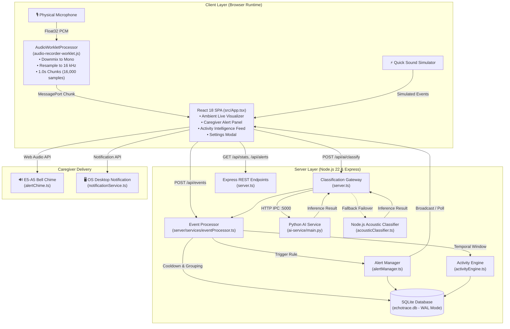
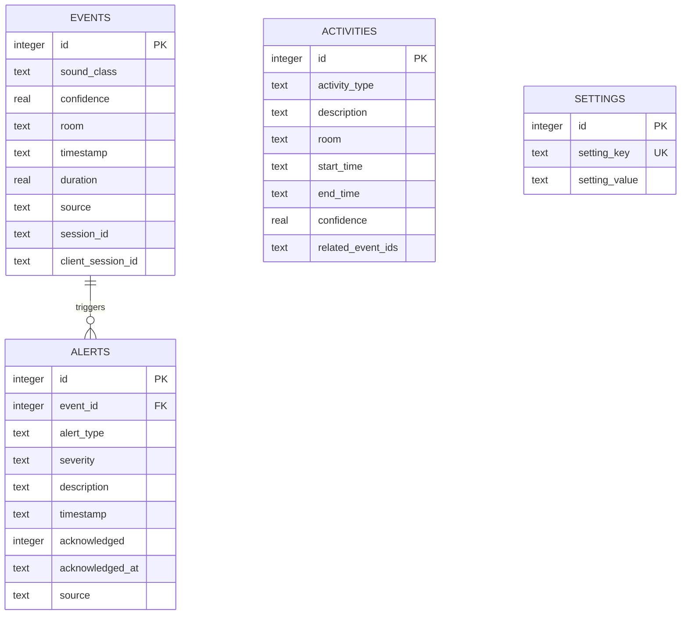

# EchoTrace – System Architecture & Engineering Specifications

This document outlines the end-to-end software architecture, component design, data flow pipelines, and security model of **EchoTrace** (Privacy-First Ambient Sound Memory Assistant for Dementia Caregivers).

---

## 1. High-Level Architectural Overview

EchoTrace operates as an integrated full-stack edge application designed to run entirely locally or on a private caregiver hub without transmitting ambient audio to third-party cloud servers.

---

## 2. Core Architectural Components

### 2.1 Audio Ingestion & Web Audio Worklet Pipeline
* **Source:** Browser `MediaDevices.getUserMedia()` capturing raw audio input.
* **Worklet Thread:** `public/audio-recorder-worklet.js` executes on a dedicated audio rendering thread decoupled from the main UI thread.
  * **Channel Averaging:** Downmixes multi-channel audio (stereo, surround) to 1-channel mono:
    $$\text{mono}[i] = \frac{1}{C}\sum_{c=0}^{C-1} \text{input}[c][i]$$
  * **Hardware-Agnostic Resampling:** Dynamically calculates resample ratio ($R = \frac{f_{\text{source}}}{16000}$). Computes fractional linear interpolation to convert arbitrary hardware rates (44.1 kHz, 48 kHz, 96 kHz) into exactly 16,000 Hz.
  * **Chunking:** Buffers exactly 16,000 samples (1.0-second temporal window).
  * **Zero-Feedback Graph:** Routes output to an explicit `GainNode` with gain `0.0` connected to `audioCtx.destination`, ensuring browser engines do not sleep or garbage-collect the worklet while preventing speaker feedback loops.
  * **Energy Gate:** Main thread computes root-mean-square ($\text{RMS} = \sqrt{\frac{1}{N}\sum x^2}$). Chunks with $\text{RMS} < 0.012$ (room silence) are suppressed prior to network transmission, conserving CPU and bandwidth.

---

### 2.2 Dual-Engine AI Sound Classification Strategy
EchoTrace employs a tiered classification architecture ensuring high model fidelity where TensorFlow is installed, while providing 100% operational uptime via an embedded TypeScript acoustic classifier.

| Dimension | Tier 1: Google YAMNet Neural Network | Tier 2: Built-in Acoustic Spectral Classifier |
| :--- | :--- | :--- |
| **Runtime** | Python 3 (`ai-service/main.py`) | TypeScript / Node.js (`acousticClassifier.ts`) |
| **Model Architecture** | Pretrained MobileNet-based convolutional network | Heuristic acoustic feature extraction |
| **Model Source** | TensorFlow Hub (`tfhub.dev/google/yamnet/1`) | Internal mathematical algorithms |
| **AudioSet Classes** | 521 AudioSet display classes | 40 Household target sound classes |
| **Feature Extraction** | Mel-frequency log spectrograms (64 bins) | Zero Crossing Rate (ZCR), RMS energy, Crest factor, Segment energy variance |
| **Deployment Mode** | Desktop / native installation with TensorFlow | Cloud containers, lean Node.js runtime, offline fallback |
| **Health Reporting** | `status: "ready"`, `is_neural_network: true` | `status: "fallback"`, `is_neural_network: false` |

---

### 2.3 Event Processing Engine (`server/services/eventProcessor.ts`)
To translate raw 1-second machine learning predictions into human-meaningful caregiver logs, every sound detection passes through three smoothing algorithms:

1. **Dynamic Confidence Gating:**
   * Predictions with confidence lower than `confidence_threshold` (stored in SQLite, default 0.40) are dropped with `status: 'rejected_threshold'`.
2. **Continuous Sound Grouping:**
   * Sounds that naturally occur over continuous periods (`Footsteps`, `Water tap, faucet`, `Shower`, `Vacuum cleaner`, `Television`, `Speech`) are not logged as separate records.
   * If an identical sound occurred within the active event duration plus `continuous_grouping_window_sec` (default 12s), the existing database record is updated in place:
     $$\text{duration}_{\text{new}} = \text{duration}_{\text{old}} + \text{duration}_{\text{chunk}}$$
     $$\text{confidence}_{\text{smoothed}} = (0.7 \times \text{confidence}_{\text{old}}) + (0.3 \times \text{confidence}_{\text{new}})$$
3. **Duplicate Cooldown Suppression:**
   * For impulsive, discrete sounds (`Knock`, `Door`, `Drawer`, `Cupboard`, `Keys jingling`), multiple detections within `duplicate_cooldown_sec` (default 4s) are suppressed with `status: 'suppressed'`, preventing repetitive log entries.

---

### 2.4 Activity Intelligence Engine (`server/services/activityEngine.ts`)
Dementia care requires understanding whether daily living routines are occurring normally. The Activity Engine periodically inspects trailing sound event clusters over a configurable correlation window (`activity_window_min`, default 15 minutes) and infers high-level human routines:

* **Kitchen Activity:** Detects combinations of water tap running, dishes/pans clattering, coffee maker operating, and microwave/refrigerator sounds $\rightarrow$ *"Possible breakfast or beverage preparation detected in Kitchen."*
* **Personal Hygiene Routine:** Detects running water, toilet flush, and shower $\rightarrow$ *"Typical bathroom hygiene routine detected."*
* **Room Transition / Arrival:** Detects doors opening/closing, keys jingling, and footsteps $\rightarrow$ *"Potential room transition or arrival detected."*
* **Media & Leisure:** Detects television or radio audio signatures $\rightarrow$ *"Resident watching television or listening to radio in Living Room."*

---

### 2.5 Caregiver Alert Routing & Delivery System
1. **Severity Classification:**
   * **Critical (Immediate Action Required):** `Smoke detector, smoke alarm`, `Fire alarm`. Sets `requireInteraction: true` on OS notifications.
   * **High (Safety Warning):** `Glass breaking`, `Loud impact / crash`.
   * **Medium / Low:** Vocal distress, crying.
2. **Temporal Duplicate Alert Suppression:**
   * Repeated triggers of the same alert type in the same room are suppressed for **3 minutes** to prevent alarming caregivers repetitively during an ongoing situation.
3. **Multi-Modal Feedback:**
   * **Visual:** Prominent color-coded banner in the top dashboard and Caregiver Alerts panel.
   * **Audible Chime:** Synthesizes a harmonic two-tone bell sequence (E5 659.25 Hz $\rightarrow$ A5 880.00 Hz) using Web Audio `OscillatorNode` with exponential decay envelopes.
   * **OS Desktop Notification:** Dispatches native desktop notification banner with click-to-focus routing.

---

### 2.6 Client Session Tracking & Multi-Tab Isolation
* Every browser session generates a unique UUID v4 / alphanumeric ID stored in `window.sessionStorage`.
* Same-tab page reloads preserve the session ID; opening new tabs creates isolated session contexts.
* The backend sanitizes session IDs using strict regex (`/^[a-zA-Z0-9_\-:.]+$/`, $\le 128$ characters) to eliminate SQL injection and malformed headers.
* The SQLite database maintains `client_session_id` alongside backward-compatible `session_id`, allowing caregivers to filter event feeds by "Current Tab" vs "All Sessions".

---

## 3. Database Architecture (SQLite)

EchoTrace stores all records in a single local file (`echotrace.db`) utilizing Write-Ahead Logging (`PRAGMA journal_mode = WAL`) and foreign key constraints (`PRAGMA foreign_keys = ON`).

---

## 4. Security, Privacy & Data Governance Model

1. **Zero Raw Audio Storage:** Raw audio buffers are strictly transient (1.0s float32 memory arrays) and are discarded immediately after feature extraction. No `.wav`, `.mp3`, or audio files are ever written to disk.
2. **No Speech-to-Text Transcription:** The system classifies acoustic frequency textures only; speech phonemes and conversation contents are never transcribed, analyzed, or stored.
3. **100% Parameterized SQL:** All SQLite operations use prepared statements (`db.prepare('...').run(?)`), preventing SQL injection.
4. **Atomic Transactions:** Multi-row settings updates utilize `db.transaction()` to ensure database consistency.
5. **Session ID Sanitization:** Input session tokens exceeding 128 characters or containing illegal punctuation are safely sanitized to `null`.
